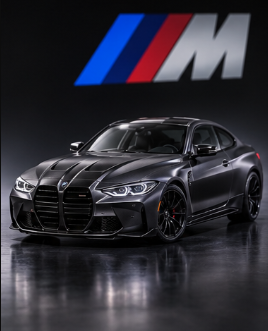
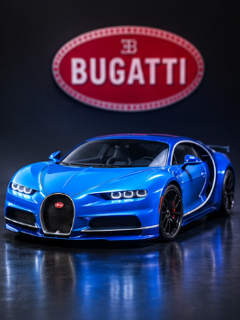
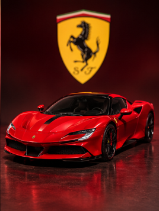
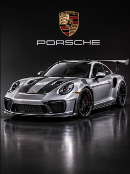
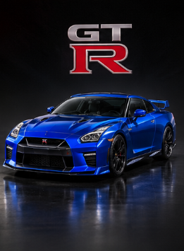
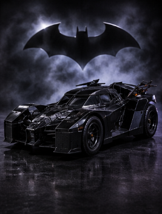
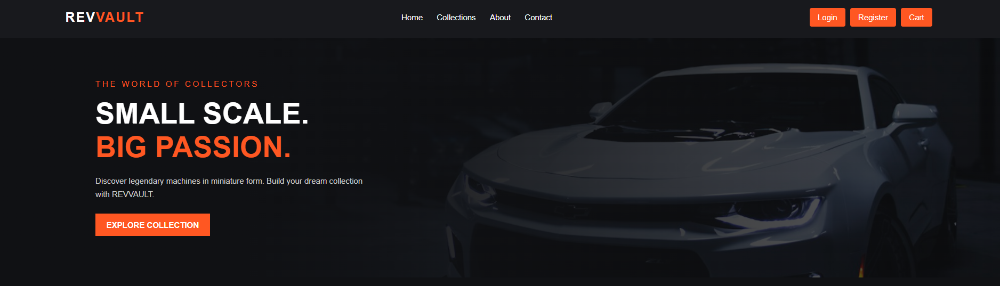
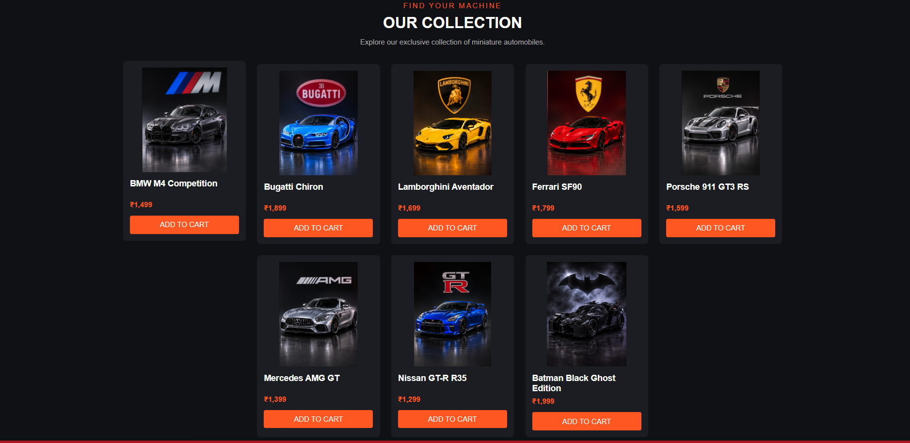
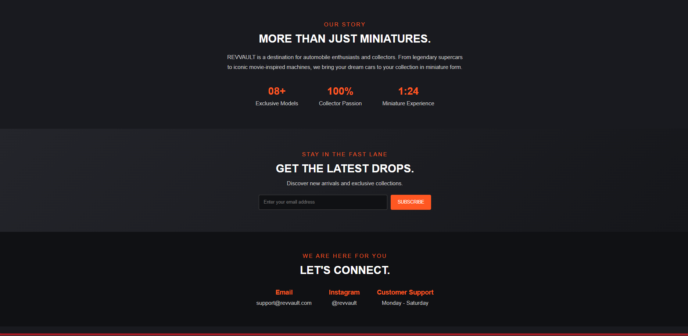
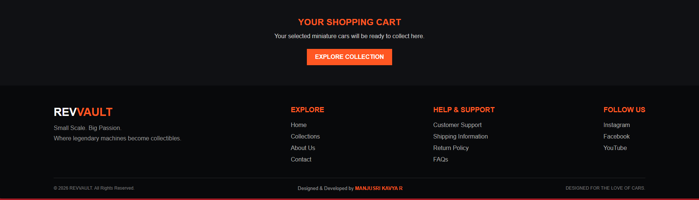

# REVVAULT – Commercial Website
### Ex02 Commercial Website
## Date:02/11/2026

## AIM
To create a commercial website using CSS Flexbox.

## ALGORITHM
### STEP 1
Create an HTML file (index.html)

### STEP 2
Create a CSS file (style.css)

### STEP 3
Include a navigation bar with links to different sections.

### STEP 4
Add structured sections for Homepage, Products / Services, About Us, Contact Details and User Account.

### STEP 5
Include social media links at the footer with copyright information.

### STEP 6
Define global styles for fonts, colors, and layout.

### STEP 7
Style the header, navigation bar, and sections.

### STEP 8
Use Flexbox for layout design.

### STEP 9
Add hover effects and transitions for interactivity.

### STEP 10
Add Images and Media.

### STEP 11
Use optimized images for a professional look.

### STEP 12
Open the HTML file in a browser to check layout and functionality.

### STEP 13
Fix styling issues and refine content placement.

### STEP 14
Deploy the website.

### STEP 15
Upload to GitHub Pages for free hosting.

## PROGRAM
index.html
```

<!DOCTYPE html>
<html lang="en">
<head>
    <meta charset="UTF-8">
    <meta name="viewport" content="width=device-width, initial-scale=1.0">

    <title>REVVAULT | Premium Miniature Cars</title>

    <link rel="stylesheet" href="style.css">
</head>

<body>

    <!-- NAVIGATION BAR -->
    <header>
        <nav class="navbar">

            <h2 class="logo">REV<span>VAULT</span></h2>

            <div class="nav-links">
                <a href="#home">Home</a>
                <a href="#collections">Collections</a>
                <a href="#about">About</a>
                <a href="#contact">Contact</a>
            </div>

            <div class="nav-actions">
                <a href="#login" class="nav-btn">Login</a>
                <a href="#register" class="nav-btn">Register</a>
                <a href="#cart" class="nav-btn">Cart</a>
            </div>

        </nav>
    </header>


    <!-- HERO SECTION -->
    <section class="hero" id="home">

        <div class="hero-content">

            <p class="subtitle">THE WORLD OF COLLECTORS</p>

            <h1>
                SMALL SCALE.
                <span>BIG PASSION.</span>
            </h1>

            <p>
                Discover legendary machines in miniature form.
                Build your dream collection with REVVAULT.
            </p>

            <a href="#collections" class="hero-btn">
                EXPLORE COLLECTION
            </a>

        </div>

    </section>


    <!-- COLLECTION SECTION -->
    <section class="collections" id="collections">

        <div class="section-heading">

            <p>FIND YOUR MACHINE</p>

            <h2>OUR COLLECTION</h2>

            <p class="description">
                Explore our exclusive collection of miniature automobiles.
            </p>

        </div>


        <!-- PRODUCT CARDS -->
        <div class="product-container">

            <div class="product-card">
                

                <h3>BMW M4 Competition</h3>

                <p>₹1,499</p>

                <a href="#cart" class="product-btn">ADD TO CART</a>
            </div>


            <div class="product-card">
                

                <h3>Bugatti Chiron</h3>

                <p>₹1,899</p>

                <a href="#cart" class="product-btn">ADD TO CART</a>
            </div>


            <div class="product-card">
                

                <h3>Lamborghini Aventador</h3>

                <p>₹1,699</p>

                <a href="#cart" class="product-btn">ADD TO CART</a>
            </div>


            <div class="product-card">
                

                <h3>Ferrari SF90</h3>

                <p>₹1,799</p>

                <a href="#cart" class="product-btn">ADD TO CART</a>
            </div>


            <div class="product-card">
                

                <h3>Porsche 911 GT3 RS</h3>

                <p>₹1,599</p>

                <a href="#cart" class="product-btn">ADD TO CART</a>
            </div>


            <div class="product-card">
                

                <h3>Mercedes AMG GT</h3>

                <p>₹1,399</p>

                <a href="#cart" class="product-btn">ADD TO CART</a>
            </div>


            <div class="product-card">
                

                <h3>Nissan GT-R R35</h3>

                <p>₹1,299</p>

                <a href="#cart" class="product-btn">ADD TO CART</a>
            </div>


            <div class="product-card">
                

                <h3>Batman Black Ghost Edition</h3>

                <p>₹1,999</p>

                <a href="#cart" class="product-btn">ADD TO CART</a>
            </div>

        </div>

    </section>


    <!-- ABOUT SECTION -->
    <section class="about" id="about">

        <p class="section-tag">OUR STORY</p>

        <h2>MORE THAN JUST MINIATURES.</h2>

        <p class="about-description">
            REVVAULT is a destination for automobile enthusiasts
            and collectors. From legendary supercars to iconic
            movie-inspired machines, we bring your dream cars
            to your collection in miniature form.
        </p>


        <div class="about-features">

            <div class="feature">
                <h3>08+</h3>
                <p>Exclusive Models</p>
            </div>

            <div class="feature">
                <h3>100%</h3>
                <p>Collector Passion</p>
            </div>

            <div class="feature">
                <h3>1:24</h3>
                <p>Miniature Experience</p>
            </div>

        </div>

    </section>


    <!-- NEWSLETTER SECTION -->
    <section class="newsletter">

        <p class="section-tag">STAY IN THE FAST LANE</p>

        <h2>GET THE LATEST DROPS.</h2>

        <p>
            Discover new arrivals and exclusive collections.
        </p>


        <form class="newsletter-form">

            <input
                type="email"
                placeholder="Enter your email address"
                required
            >

            <button type="submit">SUBSCRIBE</button>

        </form>

    </section>


    <!-- CONTACT SECTION -->
    <section class="contact" id="contact">

        <p class="section-tag">WE ARE HERE FOR YOU</p>

        <h2>LET'S CONNECT.</h2>

        <div class="contact-details">

            <div>
                <h3>Email</h3>
                <p>support@revvault.com</p>
            </div>

            <div>
                <h3>Instagram</h3>
                <p>@revvault</p>
            </div>

            <div>
                <h3>Customer Support</h3>
                <p>Monday - Saturday</p>
            </div>

        </div>

    </section>


    <!-- LOGIN SECTION -->
    <section class="account-section" id="login">

        <div class="account-box">

            <h2>WELCOME BACK</h2>

            <p>Login to your REVVAULT account.</p>

            <form>
                <input type="email" placeholder="Email Address" required>

                <input type="password" placeholder="Password" required>

                <button type="submit">LOGIN</button>
            </form>

        </div>

    </section>


    <!-- REGISTER SECTION -->
    <section class="account-section" id="register">

        <div class="account-box">

            <h2>CREATE ACCOUNT</h2>

            <p>Join the REVVAULT collector community.</p>

            <form>
                <input type="text" placeholder="Full Name" required>

                <input type="email" placeholder="Email Address" required>

                <input type="password" placeholder="Password" required>

                <button type="submit">REGISTER</button>
            </form>

        </div>

    </section>


    <!-- CART SECTION -->
    <section class="cart-section" id="cart">

        <h2>YOUR SHOPPING CART</h2>

        <p>
            Your selected miniature cars will be ready
            to collect here.
        </p>

        <a href="#collections" class="hero-btn">
            EXPLORE COLLECTION
        </a>

    </section>


    <!-- FOOTER -->
    <footer class="footer">

        <div class="footer-container">


            <!-- BRAND INFORMATION -->
            <div class="footer-brand">

                <h2>REV<span>VAULT</span></h2>

                <p>Small Scale. Big Passion.</p>

                <p>
                    Where legendary machines
                    become collectibles.
                </p>

            </div>


            <!-- QUICK LINKS -->
            <div class="footer-links">

                <h3>EXPLORE</h3>

                <a href="#home">Home</a>

                <a href="#collections">Collections</a>

                <a href="#about">About Us</a>

                <a href="#contact">Contact</a>

            </div>


            <!-- CUSTOMER SUPPORT -->
            <div class="footer-links">

                <h3>HELP & SUPPORT</h3>

                <a href="#contact">Customer Support</a>

                <a href="#contact">Shipping Information</a>

                <a href="#contact">Return Policy</a>

                <a href="#contact">FAQs</a>

            </div>


            <!-- SOCIAL MEDIA -->
            <div class="footer-social">

                <h3>FOLLOW US</h3>

                <a href="#">Instagram</a>

                <a href="#">Facebook</a>

                <a href="#">YouTube</a>

            </div>


        </div>


        <!-- COPYRIGHT -->
        <div class="footer-bottom">

            <p>&copy; 2026 REVVAULT. All Rights Reserved.</p>
            <p class="creator">Designed & Developed by <span>MANJUSRI KAVYA R</span></p>
            <p>DESIGNED FOR THE LOVE OF CARS.</p>

        </div>

    </footer>

</body>
</html>

```
style.css
```

/* GENERAL STYLING */

* {
    margin: 0;
    padding: 0;
    box-sizing: border-box;
    font-family: Arial, sans-serif;
    scroll-behavior: smooth;
}

body {
    background-color: #101114;
    color: white;
}


/* NAVIGATION BAR - FLEXBOX */

.navbar {
    display: flex;
    justify-content: space-between;
    align-items: center;
    flex-wrap: wrap;
    padding: 22px 7%;
    background-color: #18191d;
}

.logo {
    font-size: 27px;
    letter-spacing: 2px;
}

.logo span {
    color: #ff5722;
}

.nav-links {
    display: flex;
    gap: 28px;
}

.nav-links a {
    color: white;
    text-decoration: none;
    transition: 0.3s;
}

.nav-links a:hover {
    color: #ff5722;
}

.nav-actions {
    display: flex;
    gap: 10px;
    flex-wrap: wrap;
}

.nav-btn {
    background-color: #ff5722;
    color: white;
    text-decoration: none;
    padding: 10px 16px;
    border-radius: 4px;
    transition: 0.3s;
}

.nav-btn:hover {
    background-color: #d94317;
}


/* HERO SECTION */

.hero {
    min-height: 480px;
    display: flex;
    align-items: center;
    padding: 60px 10%;

    background:
        linear-gradient(90deg, #101114 25%, #101114aa),
        url("https://images.unsplash.com/photo-1492144534655-ae79c964c9d7?w=1600")
        center/cover;
}

.hero-content {
    max-width: 550px;
}

.subtitle {
    color: #ff5722;
    letter-spacing: 4px;
    margin-bottom: 18px;
}

.hero h1 {
    font-size: 58px;
    line-height: 1.15;
    margin-bottom: 20px;
}

.hero h1 span {
    display: block;
    color: #ff5722;
}

.hero-content > p:not(.subtitle) {
    margin-bottom: 25px;
    color: #cccccc;
    line-height: 1.7;
}

.hero-btn {
    display: inline-block;
    padding: 13px 22px;
    background-color: #ff5722;
    color: white;
    text-decoration: none;
    font-weight: bold;
    transition: 0.3s;
}

.hero-btn:hover {
    background-color: white;
    color: #ff5722;
}


/* COLLECTION SECTION */

.collections {
    padding: 65px 7%;
}

.section-heading {
    text-align: center;
    margin-bottom: 40px;
}

.section-heading > p:first-child {
    color: #ff5722;
    letter-spacing: 3px;
    margin-bottom: 10px;
}

.section-heading h2 {
    font-size: 34px;
    margin-bottom: 12px;
}

.section-heading .description {
    color: #aaa;
}


/* PRODUCT CONTAINER - MAIN FLEXBOX */

.product-container {
    display: flex;
    flex-wrap: wrap;
    justify-content: center;
    gap: 25px;
}

.product-card {
    background-color: #1c1d22;
    flex: 0 0 calc(25% - 20px);
    max-width: 270px;
    min-width: 200px;
    padding: 15px;
    border-radius: 8px;
    transition: 0.3s;
}

.product-card:hover {
    transform: translateY(-7px);
}

.product-card img {
    width: 100%;
    height: 230px;
    object-fit: contain;
    display: block;
    border-radius: 5px;
    background-color: #1c1d22;
}

.product-card h3 {
    margin: 15px 0 8px;
    min-height: 40px;
}

.product-card p {
    color: #ff5722;
    margin-bottom: 15px;
    font-weight: bold;
}

.product-btn {
    display: block;
    text-align: center;
    width: 100%;
    background-color: #ff5722;
    color: white;
    padding: 11px;
    border-radius: 4px;
    text-decoration: none;
    transition: 0.3s;
}

.product-btn:hover {
    background-color: #d94317;
}


/* ABOUT SECTION */

.about {
    background-color: #191a1f;
    padding: 65px 10%;
    text-align: center;
}

.section-tag {
    color: #ff5722;
    letter-spacing: 3px;
    margin-bottom: 15px;
}

.about h2,
.contact h2 {
    font-size: 32px;
    margin-bottom: 20px;
}

.about-description {
    max-width: 700px;
    margin: auto;
    line-height: 1.8;
    color: #cccccc;
}

.about-features {
    display: flex;
    justify-content: center;
    flex-wrap: wrap;
    gap: 60px;
    margin-top: 40px;
}

.feature h3 {
    color: #ff5722;
    font-size: 30px;
    margin-bottom: 8px;
}

.feature p {
    color: #cccccc;
}


/* NEWSLETTER SECTION */

.newsletter {
    text-align: center;
    padding: 65px 20px;
    background: linear-gradient(135deg, #24252b, #15161a);
}

.newsletter h2 {
    font-size: 32px;
    margin: 15px 0;
}

.newsletter > p:not(.section-tag) {
    color: #cccccc;
}

.newsletter-form {
    display: flex;
    justify-content: center;
    gap: 10px;
    margin: 25px auto 0;
    max-width: 500px;
}

.newsletter-form input {
    flex: 1;
    min-width: 0;
    padding: 13px;
    border: 1px solid #444;
    border-radius: 4px;
    background: #101114;
    color: white;
}

.newsletter-form button {
    background-color: #ff5722;
    color: white;
    border: none;
    padding: 13px 20px;
    cursor: pointer;
    border-radius: 4px;
}


/* CONTACT SECTION */

.contact {
    padding: 60px 10%;
    text-align: center;
    background-color: #101114;
}

.contact-details {
    display: flex;
    justify-content: center;
    flex-wrap: wrap;
    gap: 50px;
    margin-top: 35px;
}

.contact-details h3 {
    color: #ff5722;
    margin-bottom: 10px;
}

.contact-details p {
    color: #cccccc;
}


/* LOGIN AND REGISTER SECTIONS */

.account-section {
    display: flex;
    justify-content: center;
    padding: 35px 20px;
    background-color: #191a1f;
}

.account-box {
    width: 100%;
    max-width: 380px;
    padding: 30px;
    background-color: #202126;
    border-radius: 8px;
    display: flex;
    flex-direction: column;
    gap: 15px;
}

.account-box h2 {
    color: #ff5722;
    margin-bottom: 8px;
}

.account-box p {
    color: #cccccc;
}

.account-box form {
    display: flex;
    flex-direction: column;
    gap: 15px;
}

.account-box input {
    padding: 12px;
    border: none;
    border-radius: 4px;
}

.account-box button {
    background-color: #ff5722;
    color: white;
    border: none;
    padding: 12px;
    cursor: pointer;
    border-radius: 4px;
}


/* CART SECTION */

.cart-section {
    padding: 55px 20px;
    text-align: center;
    background-color: #101114;
}

.cart-section h2 {
    color: #ff5722;
    margin-bottom: 15px;
}

.cart-section p {
    color: #cccccc;
    margin-bottom: 25px;
}


/* FOOTER */

.footer {
    background-color: #08090b;
    padding: 55px 8% 20px;
}

.footer-container {
    display: flex;
    justify-content: space-between;
    flex-wrap: wrap;
    gap: 35px;
    padding-bottom: 40px;
}

.footer-brand h2 {
    font-size: 30px;
    margin-bottom: 12px;
}

.footer-brand h2 span {
    color: #ff5722;
}

.footer-brand p {
    color: #999999;
    line-height: 1.8;
}

.footer-links,
.footer-social {
    display: flex;
    flex-direction: column;
    gap: 13px;
}

.footer-links h3,
.footer-social h3 {
    color: #ff5722;
    margin-bottom: 8px;
}

.footer-links a,
.footer-social a {
    color: #aaaaaa;
    text-decoration: none;
    transition: 0.3s;
}

.footer-links a:hover,
.footer-social a:hover {
    color: #ff5722;
}

.footer-bottom {
    border-top: 1px solid #292929;
    padding-top: 20px;
    display: flex;
    justify-content: space-between;
    flex-wrap: wrap;
    gap: 12px;
    color: #777777;
    font-size: 12px;
}


/* TABLET RESPONSIVENESS */

@media (max-width: 900px) {

    .navbar {
        justify-content: center;
        gap: 20px;
    }

    .product-card {
        flex: 0 0 calc(50% - 15px);
    }

}


/* MOBILE RESPONSIVENESS */

@media (max-width: 600px) {

    .navbar {
        flex-direction: column;
    }

    .nav-links,
    .nav-actions {
        flex-wrap: wrap;
        justify-content: center;
    }

    .hero {
        min-height: 400px;
        padding: 45px 7%;
    }

    .hero h1 {
        font-size: 38px;
    }

    .product-card {
        flex: 0 0 100%;
        max-width: 350px;
    }

    .newsletter-form {
        flex-direction: column;
    }

    .about-features {
        gap: 30px;
    }

    .contact-details {
        flex-direction: column;
        gap: 25px;
    }

    .footer-container {
        flex-direction: column;
    }

    .footer-bottom {
        flex-direction: column;
        text-align: center;
    }

}

.creator {
    color: #999999;
    font-size: 13px;
}

.creator span {
    color: #ff5722;
    font-weight: bold;
}

```
## OUTPUT










## RESULT
The program for creating commercial website using CSS Flexbox is executed successfully.